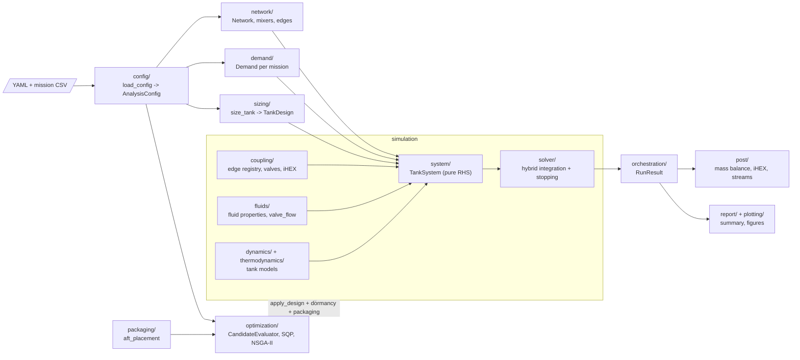

# Thermomechanical OPtimisation LAB (TOPLAB)

TOPLAB is a modular analysis tool for the design of composite hydrogen storage tanks for aviation, capable of capturing interactions between tanks and other fuel system components.

This repository hosts the official implementation accompanying the paper:

> *"A thermomechanical model of on-board multi-state hydrogen fuel systems in aviation"*
> Proceedings of the 2nd Vienna Aviation Days 2025.

## Repository Scope

TOPLAB is the **library**. All runnable analyses and optimisation studies have
moved to the companion repository **toplab-apps** (private). This repository
provides the installable `toplab` Python package and a set of worked examples
in `examples/`.

The main package lives under `toplab/`.

## Installation

TOPLAB is a standard Python package. Install it in editable mode with pip:

```bash
pip install -e .
```

After installation, `import toplab` resolves from anywhere in the active
environment without any `sys.path` manipulation.

## Environment Setup

The repository includes a micromamba / conda environment definition at `hython.yaml`.

Create the environment from the repository root with:

```bash
micromamba env create -f hython.yaml
micromamba activate hython
```

If the environment already exists and you want to sync it to the current dependency set:

```bash
micromamba env update -f hython.yaml --prune
micromamba activate hython
```

Equivalent conda commands also work:

```bash
conda env create -f hython.yaml
conda activate hython
```

After activation, a quick sanity check is:

```bash
python -c "import yaml, seaborn, CoolProp, numpy, scipy, matplotlib, pytest"
```

For workflows that generate PGF figures or build the LaTeX documentation, the same environment also carries the required TeX tooling (`pdflatex` via `texlive-core` and `latexmk`). You can verify that with:

```bash
which pdflatex
which latexmk
```

The audited environment definition includes runtime, plotting, test, and documentation dependencies used across the repository, including plotting support (`seaborn`), YAML parsing (`pyyaml`), and LaTeX tooling for PGF/document builds.

## General Spirit of the Code

TOPLAB is designed around a few core ideas:

- Physics-first, architecture-second: governing equations and thermodynamic consistency are treated as primary design constraints, and software structure is built to preserve them.
- Graph-based system modelling: fuel systems are represented as directed networks of nodes and edges, so topology changes are handled in configuration rather than by rewriting solver code.
- Modular components: tanks, couplings, valves, peripheral conditioning elements, and thermal models are implemented as composable building blocks.
- Configuration-driven studies: scenarios are expressed in YAML and executed through common orchestration paths, enabling reproducible comparisons across missions and architectures.
- Extensibility with control: new mechanisms (for example, edge models or component chains) are intended to be added as explicit modules, not ad hoc special cases.

In practice, this means the codebase aims to make it easy to:

1. Encode a new multi-tank architecture from configuration.
2. Run the same numerical machinery across different mission profiles.
3. Compare physical assumptions and design choices without duplicating solver logic.


## Code Architecture

Every analysis follows one pipeline: a YAML file becomes a typed config, the config is turned into a network and a demand, tanks are sized as pure functions, a pure right-hand side is integrated by a hybrid solver, and the finished run is bundled into a read-only `RunResult` that post-processing, reports and plots consume.



| Layer | Package | Responsibility |
|-------|---------|----------------|
| Input | `config/` | Parse YAML into frozen, validated dataclasses (`AnalysisConfig`, `TankSpec`, `MissionSpec`, `EdgeSpec`). |
| Topology | `network/` | Tank indexing, mixers with `flow_fraction`, coupling edges, demand routing. |
| Demand | `demand/` | Single mission-flow interface (combined or GT/FC split) shared by every consumer. |
| Design | `sizing/` | `size_tank(spec) -> TankDesign`, no side effects. |
| Physics | `fluids/`, `dynamics/`, `thermodynamics/` | Fluid properties, single-phase and two-phase tank models, adiabatic pipe-orifice-pipe valve flow. |
| Coupling | `coupling/` | Edge registry. An edge owns its extra states, its pure `flow(t, tank_states, x)` and its mode-switch events. |
| System | `system/` | `TankSystem`: assembles the pure right-hand side from tanks and edges. |
| Solver | `solver/` | Hybrid integration (continuous ODE plus terminal events for mode switches) and stopping criteria. |
| Orchestration | `orchestration/` | `SystemOrchestrator` wires the pipeline; `RunResult` is the read-only output bundle. |
| Output | `post/`, `report/`, `plotting/` | Mass-balance validation, iHEX sizing, stream data, summaries and figures. |
| Packaging | `packaging/` | Aft-fuselage placement and packaging margin. |
| Optimisation | `optimization/` | Design variables, shared `CandidateEvaluator` (discharge, dormancy, packaging), SQP and NSGA-II. |
| Legacy | `legacy/` | Fenced-off feedforward pressure enforcer and old `FlowPhysics`; deprecated. |

Optimisers never write temporary YAML files. A candidate design is produced by `apply_design` (a `dataclasses.replace` on the typed config) and evaluated in-process.

## Examples

A selection of ready-to-run analyses lives under `examples/`. Each example
follows the same pattern as toplab-apps studies: a driver script, a YAML
configuration, and shared mission CSVs read from `missions/`.

Run from the repository root after installing the package:

```bash
python examples/single_tank_cch2/driver_single_tank_cch2.py
```

Available examples:

| Directory | Description |
|-----------|-------------|
| `single_tank_ch2` | Gaseous hydrogen single-tank discharge |
| `single_tank_cch2` | Cryo-compressed hydrogen single-tank discharge |
| `single_tank_slh2` | Subcooled liquid hydrogen single-tank discharge |
| `coupled_ch2_cch2` | CH2–CCH2 coupled system with pressure compensation |
| `coupled_ch2_lh2` | CH2–LH2 coupled system with flow-controlled pressurisation |
| `optimization_two_tank_cch2` | Two CcH2 tanks on the ATR72 mission: SQP (`python -m toplab.optimization.runners sqp two_tank_cch2_sqp.yaml`) and NSGA-II (`driver_nsga2_two_tank_cch2.py`) over the tank radii |

The NASA Modified Lockheed MLI heat-flux correlation can be inspected with
`python examples/modified_lockheed_mli.py`. It prints component heat fluxes for
representative cryogenic temperatures and thicknesses, plots total heat flux,
and reports a residual-gas pressure sensitivity. The script saves the figures
as `examples/output/modified_lockheed_thickness_sweep.png` and
`examples/output/modified_lockheed_pressure_sensitivity.png`.

The Modified Lockheed model is a semi-empirical MLI correlation returning
`q` in W/m². Temperatures are in K, layer density is in layers/cm, and
physical insulation thickness is in m, and interstitial pressure is in torr.
`Cs`, `Cr`, and `Cg` are empirical constants; the published Modified Lockheed
defaults are `Cs = 2.4e-4`, `Cr = 4.944e-10`, and `Cg = 1.46e4`, with
`epsilon = 0.031`. Its default
degradation factor `Df = 1` represents ideal blanket performance; practical
tank-applied MLI may require a degradation factor to account for seams,
penetrations, edges, and installation imperfections. Configure this option as
`model: modified_lockheed` in the insulation block; available correlation
settings include `layer_density`, `pressure_torr`, `emissivity_mli`,
`degradation_factor`, `Cs`, `Cr`, and `Cg`. Effective insulation
`density` and constant `specific_heat` continue to use the existing lumped
thermal-mass treatment.

The outer shell is configured with `alpha_shell` (ambient convective coefficient)
and `emissivity_shell`. The legacy names `alpha_amb` and `emissivity` are still
accepted for the shell; `emissivity` only refers to the MLI emissivity when
`emissivity_shell` is also given.

The supported insulation selections are foam (`foam` or `rohacell`) and
`modified_lockheed`. The previous equivalent MLI conductivity-fit option
(`mli`) is not working and is rejected by configuration loading; it is
retained only as historical code and is not covered by tests.

Reference: Hastings, L. J., Hedayat, A., and Brown, T. M.,
"Analytical Modeling and Test Correlation of Variable Density Multilayer
Insulation for Cryogenic Storage," NASA/TM-2004-213175.

## Analyses and Optimisation Studies

Full analysis and optimisation case sets live in the companion repository
**toplab-apps**. See that repository for the complete study suite and its
own environment setup instructions.

## Contact

For questions related to the paper or early access inquiries:

- d.raso@tudelft.nl

---

## Citation

If you use this work, please cite:

```bibtex
@article{raso2026,
	title     = {A thermomechanical model of on-board multi-state hydrogen fuel systems in aviation},
	author    = {Dante Raso and Nils Wieja and Jan Conde-Wolter and Lukas Hauser and Christoph Ebert and Bianca Giovanardi and Maik Gude and Julien van Campen},
	journal   = {Proceedings of the 2nd Vienna Aviation Days},
	publisher = {Springer Nature},
	year      = {2026}
}
```
